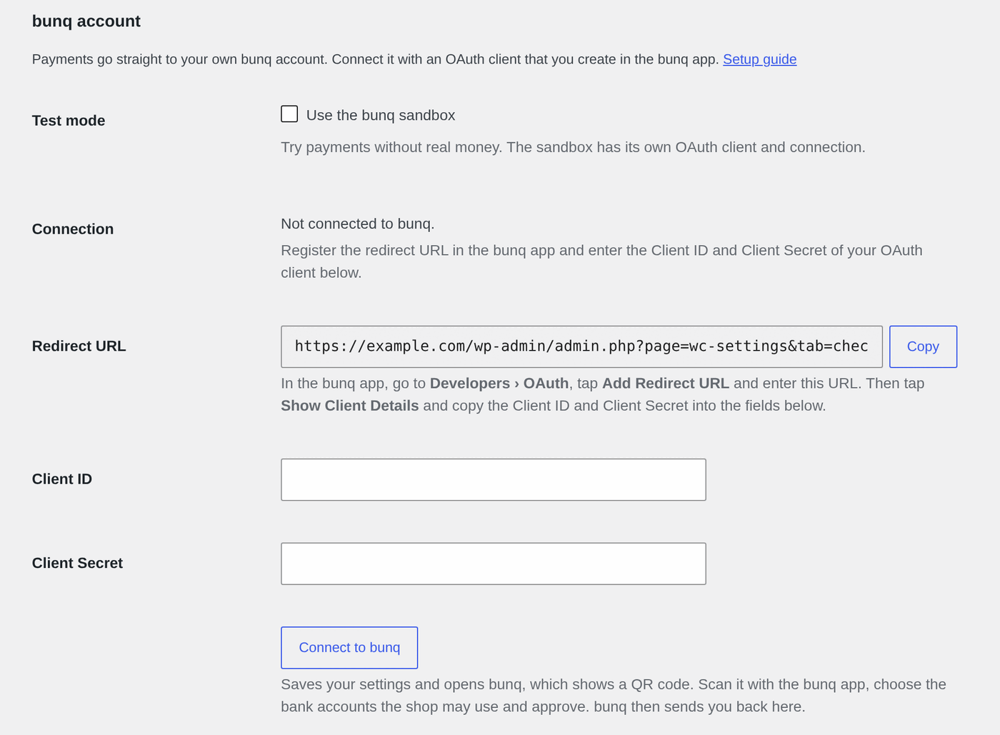
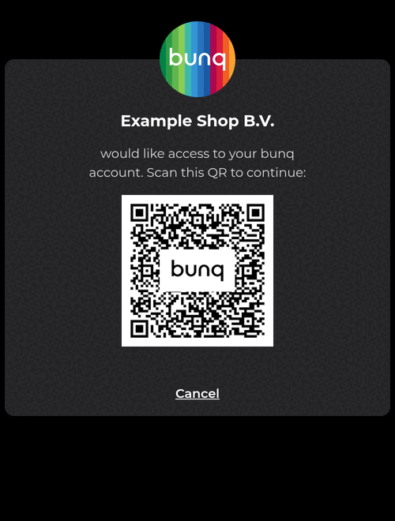
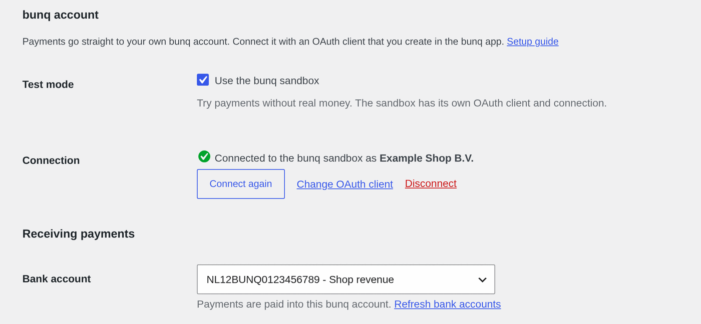

# bunq for WooCommerce

> `readme.txt` is the readme for the WordPress.org plugin directory; keep its `Stable tag` equal to the plugin version and its changelog up to date with every release.

Contributors: patrickkivits\
Donate link: https://bunq.me/patrickkivits \
Tags: woocommerce, psp, payment gateway, bunq, ideal, credit card, bancontact\
License: GPLv2 or later\
License URI: http://www.gnu.org/licenses/gpl-2.0.html

Accept payments in your WooCommerce shop with just your bunq account.

## Features

- iDEAL, credit and debit cards, Bancontact and bunq-to-bunq transfers through a [bunq.me](https://bunq.me) payment request.
- Orders are confirmed by bunq's callback, again when the customer returns to the shop, and by background checks (WooCommerce's Action Scheduler) in case the callback never arrives.
- Payment requests that bunq reports as expired or cancelled cancel the order; cancelling an order cancels its payment request at bunq.
- Refunds from the WooCommerce order screen, created as a bunq draft payment back to the IBAN the payment came from and approved in the bunq app.
- Works with the classic checkout and the block checkout, and with High-Performance Order Storage.
- Translated into Dutch, French and German; other languages can be added from the `languages/` template.

## Demo

https://bunq-for-woocommerce.patrickkivits.com/

## Requirements

- [bunq account](https://bunq.com/invite/patrickkivits)
- HTTPS/SSL certificate (for callbacks/payment processing to work)
- PHP version: >= 7.3 (up to and including 8.5)
- PHP extensions: openssl, curl, json, mbstring
- WordPress version: >= 4.7
- WooCommerce version: >= 2.2

## Installation

1. Download `bunq-for-woocommerce.zip` from the [latest release](https://github.com/patrickkivits/bunq-for-woocommerce/releases/latest/download/bunq-for-woocommerce.zip).
2. In your WordPress admin panel, navigate to **Plugins** > **Add New**.
3. Click Upload Plugin.
4. Upload the zip file that you downloaded.

### Updating

Upload the new `bunq-for-woocommerce.zip` the same way. WordPress recognises the installed plugin and offers **Replace current with uploaded**, which keeps your settings.

## Configuration

1. In your WordPress admin panel, navigate to **WooCommerce** > **Settings** > **Payments** > **bunq**.
2. Under **bunq account**, leave **Test mode** unchecked to receive real payments. To try the plugin first, check **Use the bunq sandbox** and use a bunq sandbox account in the steps below.
3. Click **Copy** next to the **Redirect URL**. In the bunq app, navigate to **Developers** > **OAuth**, tap **Add Redirect URL** and paste it.
4. In the bunq app, tap **Show Client Details** and copy the **Client ID** and **Client Secret** into the fields with the same name.



5. Click **Connect to bunq**. This saves the settings and opens bunq, which shows a QR code.
6. Scan the QR code with the bunq app, choose the bank accounts the shop may use and approve.



7. bunq sends you back to the settings page, where **Connection** now says *Connected to bunq as* followed by your name.
8. Under **Receiving payments**, select the **Bank account** payments are paid into. Check **Enable bunq Gateway** at the top of the page and click **Save changes**.



Under **Checkout** you set the title and description customers see. With **Enable direct gateway** customers choose iDEAL, card, Bancontact or a bunq transfer on the checkout page; **Payment methods** limits which of them are offered.

### Managing the connection

Once the shop is connected, the settings page hides the Client ID and Client Secret and shows three actions next to **Connection**:

- **Connect again**: scan a new QR code, for example after bunq rejected the connection.
- **Change OAuth client**: shows the Client ID and Client Secret fields again to switch to another OAuth client.
- **Disconnect**: the shop forgets its access to bunq. Remove the connection in the bunq app to revoke it at bunq as well.

Live mode and the sandbox each have their own OAuth client and connection; the **Test mode** checkbox switches between them. The Client Secret is never shown again after saving it: leave the field empty to keep it.

The bank account list is cached for an hour. Click **Refresh bank accounts** below the bank account select after adding an account in the bunq app.

## Refunds

Open the order in WooCommerce, click **Refund**, enter the amount and choose **Refund via bunq**. The plugin creates a **draft payment** at bunq back to the IBAN the payment came from and adds a note with the draft payment id to the order. Approve the draft in the bunq app (it appears as a pending payment on the account) to actually send the money; bunq does not let an OAuth-connected app pay an external IBAN without that approval.

WooCommerce records the refund as soon as the draft is created, so an unapproved draft leaves the order marked as refunded while the customer has not received anything. Payments without a counterparty IBAN (for example card payments) cannot be refunded through the API; refund those from the bunq app.

## Troubleshooting

Everything the plugin does with bunq (callbacks received, payments matched, refunds, errors) is written to **WooCommerce** > **Status** > **Logs** (source: `bunq`). Look there first when an order does not change status.

If the settings page still says *Not connected* after connecting, or the **Bank account** dropdown shows *bunq rejected the saved connection*:

1. The plugin shows the error returned by bunq at the top of the plugin settings page right after the redirect back from bunq.
2. Full details are written to **WooCommerce** > **Status** > **Logs** (source: `bunq`).
3. Make sure the redirect URL registered in the bunq app is **exactly** the redirect URL shown on the settings page, including `&section=bunq`.
4. Every attempt whitelists the IP address the request was sent from. If your host sends outgoing requests from changing IP addresses, bunq may reject the session with *Incorrect API key or IP address*.

## Optional configuration

By default WooCommerce will **hold stock** for unpaid orders for **60 minutes**. When this limit is reached, the pending order will be **cancelled**.

Some payment methods provided by bunq.me may take longer than that to complete. To avoid premature cancellation this setting can be increased or disabled in the WooCommerce configuration here: **WooCommerce** > **Settings** > **Products** > **Inventory** > **Hold stock (minutes)**. The plugin keeps checking unpaid orders in the background for two days and cancels an order once bunq reports its payment request as expired.

## Translations

The plugin ships with Dutch (`nl_NL`), French (`fr_FR`) and German (`de_DE`) translations. To add a language, translate `languages/bunq-for-woocommerce.pot` with a tool such as Poedit and save the `.po` and `.mo` files as `languages/bunq-for-woocommerce-<locale>.po`. After changing strings in the code, regenerate the template with:

```
php .github/scripts/make-pot.php
```

The bunq.me payment page itself is hosted by bunq and follows the language of the customer's browser.

## Development

The plugin's code lives in `src/` as namespaced classes (`PatrickKivits\BunqForWooCommerce`), loaded through the committed Composer autoloader (PSR-4). `bunq-for-woocommerce.php` only defines the plugin file constant, loads the autoloader and boots `Plugin`, which registers every hook:

| Class | Responsibility |
| --- | --- |
| `Plugin` | Hooks into WordPress and WooCommerce, shares the bunq API client within a request |
| `Requirements` | Checks WordPress, WooCommerce, PHP and OpenSSL; deactivates the plugin when they do not suffice |
| `Gateway\Gateway` | The WooCommerce payment gateway: settings, checkout, payments, refunds, payment status |
| `Gateway\CallbackHandler` | The callback bunq sends to `/wc-api/wc_bunq_gateway/` |
| `Gateway\PaymentMethods`, `Gateway\SettingsFields` | The bunq.me payment methods and the settings form |
| `Orders\PaymentMonitor` | Payment checks on return and from Action Scheduler; cancels the bunq payment request of cancelled orders |
| `Blocks\CheckoutIntegration` | The block checkout payment method (script in `assets/js/block-checkout.js`) |
| `Bunq\ApiClient`, `Bunq\ApiException`, `Bunq\OAuthClient` | Every call to bunq (signed, verified, rate limited and retried; no bunq SDK) and its errors, and the OAuth authorization |

Secrets: the API keys and API contexts (which hold the private key and the session token) live in the `bunq_for_woocommerce_credentials` option, which is not autoloaded and is never a settings field, so the settings page and the WooCommerce REST API neither show nor accept them. The OAuth client secret is a settings field that is never rendered back. Everything logged or shown as an error goes through `Logger`, which masks every value registered with `Logger::add_secret()`; register any new secret there. The OAuth return is only handled for a user with `manage_woocommerce` on the settings page (`Gateway::is_oauth_return()`), with the state that user's authorization request stored.

The class names of earlier versions (`WC_Bunq_Gateway`, `WC_Bunq_WooCommerce_Block_Checkout`) still resolve to these classes. After adding a class, nothing needs to be regenerated; after changing the `autoload` section of `composer.json`, run `composer dump-autoload` in the repository root.

There are two test suites, both installed from `tests/composer.json` so that nothing lands in the committed `vendor/` directory that ships in the plugin zip:

```
composer install --working-dir=tests
```

**Unit tests** run without WordPress: `tests/stubs/` stands in for the WordPress and WooCommerce functions the plugin calls, and nothing talks to bunq. They cover the pure logic (rate limiting, retries, description sanitising, scheduling) and run on PHP 7.3 up to 8.5.

```
tests/vendor/bin/phpunit
```

A few tests in the `slow` group wait for the real `sleep()` calls of the rate limit handling; skip them while iterating with `tests/vendor/bin/phpunit --exclude-group slow`.

**Integration tests** run the plugin inside a real WordPress and WooCommerce, using the WordPress test suite ([wp-phpunit](https://github.com/wp-phpunit/wp-phpunit)) with WordPress core and WooCommerce installed by composer under `tests/`. They exercise the gateway against the real settings API, cart, orders, order status transitions and Action Scheduler; only the calls to bunq itself stay out of reach. They need a MySQL or MariaDB database that they may empty, reachable through `WP_TESTS_DB_NAME`, `WP_TESTS_DB_USER`, `WP_TESTS_DB_PASSWORD` and `WP_TESTS_DB_HOST` (defaults: `wordpress_tests`, `root`, `root`, `127.0.0.1`). For example with Docker:

```
docker run -d --name bunq-wc-tests -e MARIADB_ROOT_PASSWORD=root -e MARIADB_DATABASE=wordpress_tests -p 3306:3306 mariadb:10.11
tests/vendor/bin/phpunit -c phpunit-integration.xml.dist
```

The unit and integration suites share `tests/FakeBunqApi.php`, which stands in for bunq so the payment, payment status, refund and API context flows run without a bunq account.

The code follows the [WordPress Coding Standards](https://github.com/WordPress/WordPress-Coding-Standards) and stays compatible with PHP 7.3 (configured in `phpcs.xml.dist`):

```
tests/vendor/bin/phpcs
```

The WooCommerce version under test is the one pinned in `tests/composer.lock`; update it with `composer update --working-dir=tests wpackagist-plugin/woocommerce`. The suites and the coding standards check run on every push through GitHub Actions.

## Disclaimer

THE SOFTWARE IS PROVIDED "AS IS", WITHOUT WARRANTY OF ANY KIND, EXPRESS OR IMPLIED, INCLUDING BUT NOT LIMITED TO THE WARRANTIES OF MERCHANTABILITY, FITNESS FOR A PARTICULAR PURPOSE AND NONINFRINGEMENT. IN NO EVENT SHALL THE AUTHORS OR COPYRIGHT HOLDERS BE LIABLE FOR ANY CLAIM, DAMAGES OR OTHER LIABILITY, WHETHER IN AN ACTION OF CONTRACT, TORT OR OTHERWISE, ARISING FROM, OUT OF OR IN CONNECTION WITH THE SOFTWARE OR THE USE OR OTHER DEALINGS IN THE SOFTWARE.
